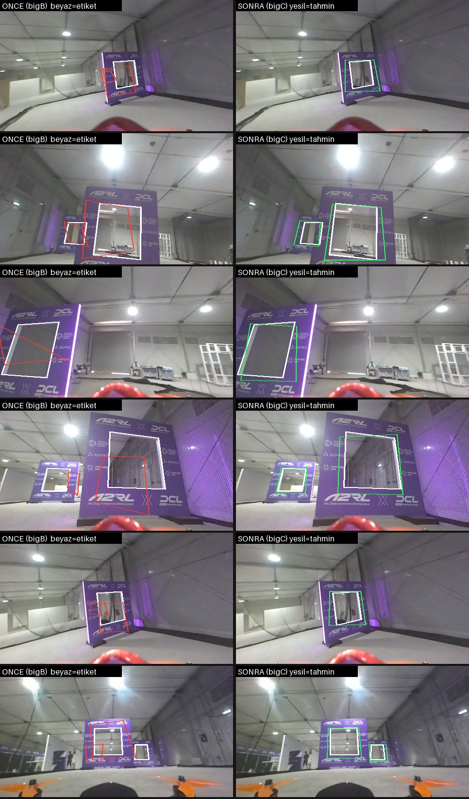
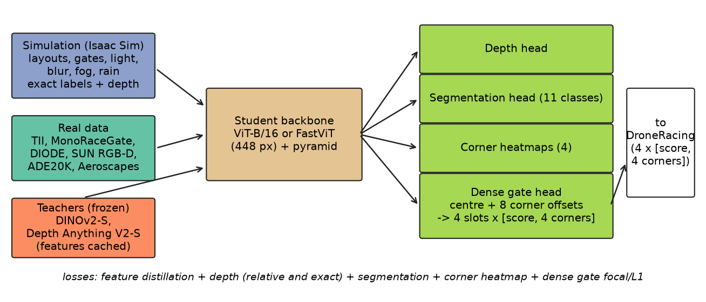
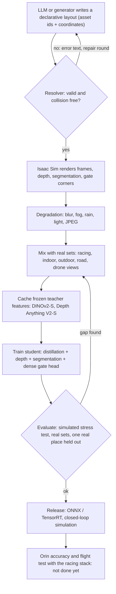
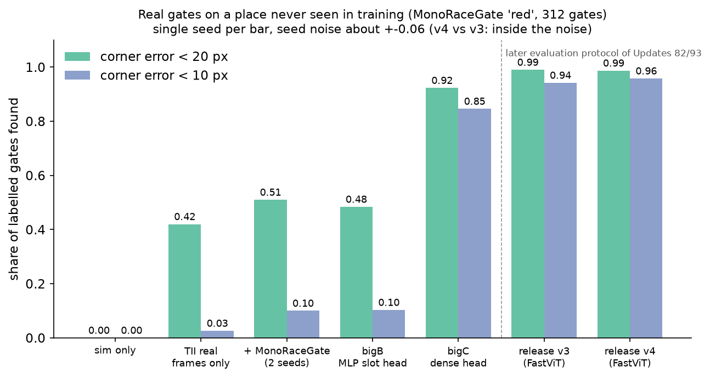
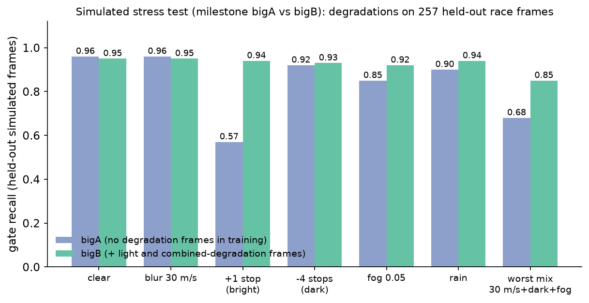
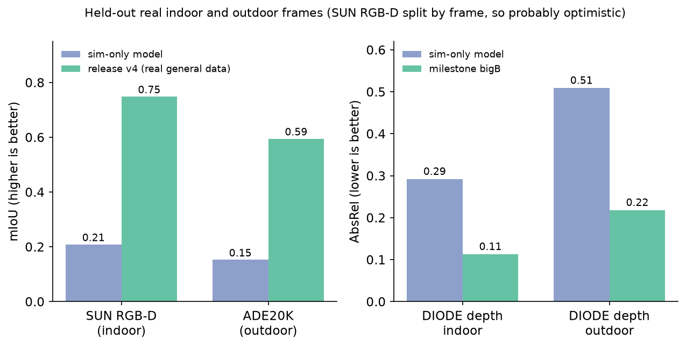
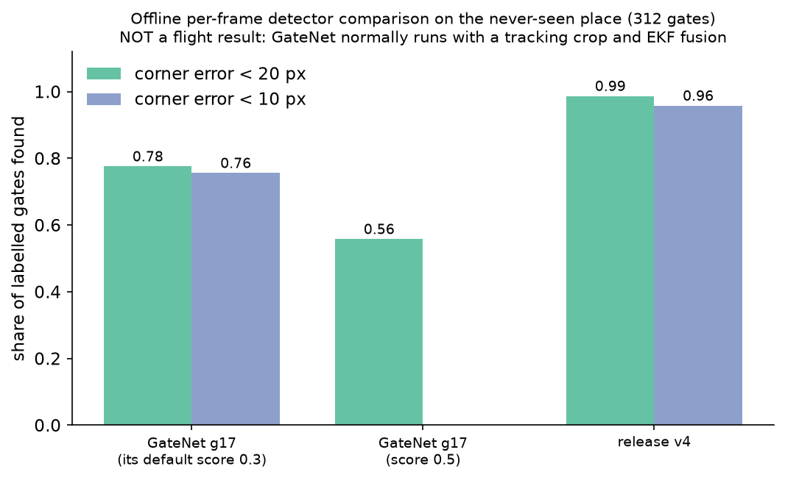

🇬🇧 English · 🇹🇷 [Türkçe](README.tr.md)

# PerceptionModel

**A small vision network for drone racing: racing-gate corners, depth and scene segmentation from one camera image, trained on simulation plus real data.**

A ViT-B or FastViT student is distilled from DINOv2-S and Depth Anything V2-S (cached teacher features) and trained with exact labels from Isaac Sim and with real racing, indoor and outdoor datasets. The current release (v4) is a FastViT-SA24 hybrid (11.0 M parameters, 0.89 ms in TensorRT fp16 on an RTX 5090, GPU compute only) that outputs up to 8 gates per frame as [score, 4 corners], for a Jetson Orin NX feeding a gate-based racing stack.



*Real frames from a place the network never saw in training (MonoRaceGate "red"). White = label. Left: bigB (global slot head), red = prediction. Right: bigC (dense gate head), green = prediction. The current release is better still, see Result 1.*

## Summary

| Problem | Method | Simulation / hardware | Paper |
|---|---|---|---|
| Gate corners (also partly out of view), depth and scene segmentation at high speed with blur, fog, rain and low light, from one small network | Multi-teacher feature distillation + exact simulated labels + real labelled sets; dense gate head (centre heatmap and corner offsets); augmentation; gate-free real negatives | Isaac Sim 6.0 data factory (LLM-declared layouts validated by a resolver); one RTX 5090 for training; target Jetson Orin NX 8 GB | TODO: no paper yet (`paper/` is empty). Project report (Turkish, 4th edition): [docs/report/PerceptionModel_rapor_v4.pdf](docs/report/PerceptionModel_rapor_v4.pdf) |

### System architecture



Two students share the same heads: a plain ViT-B/16 and a FastViT hybrid (TensorRT friendly, the release model). Teachers are frozen and their features are cached once. The gate output has the layout of a racing stack's input: slots of one score and four corners that may lie outside the image.

### Flow diagram (how it works)



## Selected results

All numbers are single-seed unless stated. On the 312-gate real test the seed noise is about +-0.06. Simulation numbers are not a success rate, and no real flight has been flown with this network.

### Result 1: real gates on a place never seen in training



Simulation-only students find essentially no real gate. Real frames, and above all a dense gate head with augmentation and gate-free negatives, lift the share of gates found within 20 px (256x192 scale) on MonoRaceGate "red" (196 images, 312 gates, never trained on) from about 0.5 to 0.92 (bigC) and, with the later recipes, to 0.99 (v3) and 0.99 (v4); within 10 px 0.94 and 0.96, the two releases being inside the seed noise. The bars right of the dashed line come from a later evaluation protocol (see [Updates 82 and 93](docs/experiment-log.md)). One place and one camera type.

### Result 2: simulated stress test



Light-varied and combined-degradation training frames close the bright-light collapse (+1 stop: 0.57 to 0.94) and lift a hard case (30 m/s blur + dark + fog) from 0.68 to 0.85 (milestone models bigA and bigB, old order-based metric). The latest release is still weak in the hardest mix: about 0.60 gate recall in simulation.

### Result 3: real indoor and outdoor frames



Public indoor and outdoor sets mapped to the project classes raise held-out real segmentation from 0.21 / 0.15 to 0.75 / 0.60 mIoU (SUN RGB-D / ADE20K) and halve the depth error. SUN RGB-D is split by frame, so it is probably optimistic. The release also reports lane-marking IoU 0.80 and zero-shot results on road, drone and off-road sets, see [Update 93](docs/experiment-log.md).

### Result 4: against the racing stack's own gate detector (offline)



On the same never-seen place the DroneRacing GateNet g17 (trained on simulator data only) finds 0.78 of the gates within 20 px at its default threshold, ours 0.99. This compares detectors frame by frame; GateNet normally runs with a tracking crop and EKF fusion, which the test does not include. It is not a flight success rate. Closed-loop gate passing in simulation (6 held-out layouts, simple point-mass controller) is saturated for all recent models (175/176 gates) and does not separate them.

*All figures are in `plots/`. Open: Orin accuracy and speed of the release weights, a real camera of the target drone (the sim uses a 130 degree camera), gates smaller than 8 px, flights. Every experiment with its caveats: [docs/experiment-log.md](docs/experiment-log.md).*

## Installation

Requirements: Linux, Python 3.12, an NVIDIA GPU (training was done on an RTX 5090, CUDA 12.8 build of PyTorch), `uv` or `pip`.

```bash
git clone https://github.com/GulogluHaktan/PerceptionModel.git
cd PerceptionModel
uv venv --python 3.12 .venv
uv pip install -p .venv/bin/python -e . pytest
.venv/bin/python -m pytest tests -q          # expected: all tests pass (65 at the time of writing)
```

`requirements.lock` pins the versions used on the workstation. Isaac Sim scripts (`sim/`, `scripts/layout_to_job*.py`) need Isaac Sim 6.0 and are optional.

## Usage

No trained checkpoint is published in this repository. A smoke run on fake data checks the whole pipeline:

```bash
.venv/bin/python scripts/make_fake.py
.venv/bin/python scripts/cache_teachers.py configs/smoke.yaml
.venv/bin/python scripts/train.py configs/smoke.yaml
```

Expected output: one JSON line per epoch, for example `{"epoch": 0, "loss": ..., "sec": ..., "peak_gb": ...}`, a line with the golden-set metrics (fake data, so meaningless numbers), then `final.pt` under the configured `out_dir`.

Real data sets are fetched and converted with the `scripts/*_prepare.py` scripts. Datasets are not redistributed here (see Data and licences).

## Reproducing the results

The experiment chains ran on one workstation and expect the intermediate folders created by the earlier steps (`data/mix/...`). The log describes each step and the exact recipe keys.

| Figure | Command |
|---|---|
| `plots/sonuc_1.png` | train: `KIND=hybrid python scripts/bige_chain.py <tag> '<key: value>' ...` (recipes of v3 and v4 in Updates 79-93 of the log); evaluate: `PFM_GATE_HEAD=dense GOLDEN=data/real_mrg/golden FLIGHTS=red_s1_f1,red_s1_f2,red_s1_f3 CKPT=runs/<tag> python scripts/eval_real_golden.py` |
| `plots/sonuc_2.png` | `KINDS=vit CKPT=runs/<tag> python scripts/eval_robustness_sim.py 4` (training: `scripts/bigb_chain.py`) |
| `plots/sonuc_3.png` | `scripts/diode_prepare.py`, `sun_prepare.py`, `ade_prepare.py`, then `python scripts/eval_depth_diode.py` and `EVDIR=data/general/eval_ade python scripts/eval_seg_sun.py` |
| `plots/sonuc_4.png` | `python scripts/eval_dr_gatenet_real.py` (needs the GateNet weights from the DroneRacing project) |
| closed-loop simulation | `bash scripts/closed_loop_batch.sh` (needs Isaac Sim and Isaac Lab) |
| ONNX / TensorRT | `python scripts/export_onnx.py ...`, `python scripts/trt_build.py ...` |
| `assets/architecture.png`, `plots/*.png` | `python scripts/make_readme_figures.py` (draws the numbers from the log) |
| `assets/real_gates_compare.jpg` | `python scripts/vis_real_gates.py` |

## Project structure

```
PerceptionModel/
├── assets/        # README images, 3D asset metadata (meshes not versioned)
├── configs/       # training and data configs (yaml)
├── docs/          # experiment log, report (Turkish PDF), protocol, notes
├── paper/         # paper (empty for now)
├── plots/         # result figures used above
├── scripts/       # data preparation, training chains, evaluations, export
├── sim/           # Isaac Sim scene scripts
├── src/pfm/       # model, losses, training, effects, layout resolvers, evaluation
├── tests/         # unit tests
├── pyproject.toml
├── requirements.lock
└── README.md
```

## Data and licences

Datasets are downloaded by the preparation scripts and are not part of this repository. Check each licence before reuse. Used for training or evaluation: TII Racing (CC BY 4.0, attribution required, frames appear in some figures and in the report), MonoRaceGate (MIT), ADE20K via Hugging Face (BSD), Aeroscapes (CC BY-SA 4.0), SUN RGB-D and DIODE (see their dataset cards). **Research or non-commercial use only:** BDD100K, RUGD and IDD-AW; UAVid and KITTI are CC BY-NC-SA. Weights trained with these sources inherit that limit; for commercial use they must be removed and the model retrained. The 3D asset catalogue meshes (375 MB) are kept out of git, only their small metadata files are versioned.

## Citation, licence, contact

```bibtex
@misc{perceptionmodel2026,
  title  = {PerceptionModel: a small multi-task vision network for drone racing},
  author = {GulogluHaktan},
  year   = {2026},
  url    = {https://github.com/GulogluHaktan/PerceptionModel}
}
```

Licence: TODO, none chosen yet (until one is added the code is all rights reserved). Contact: open an issue on this repository.
