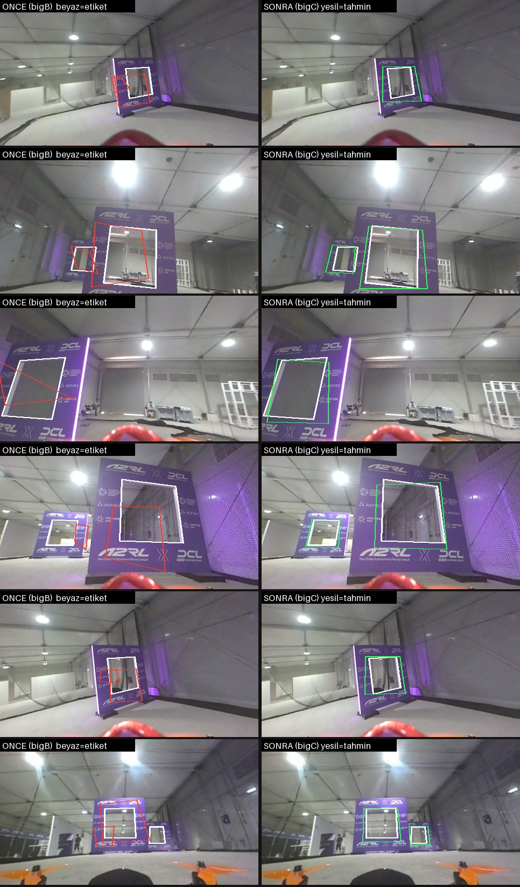
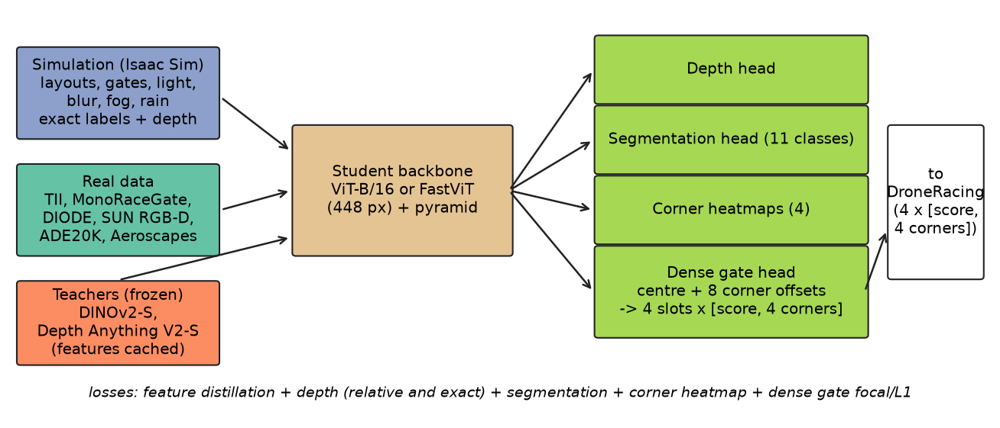
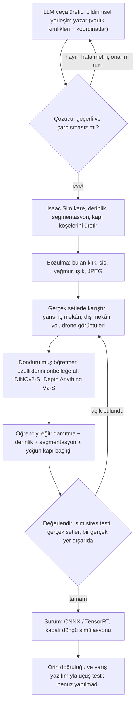
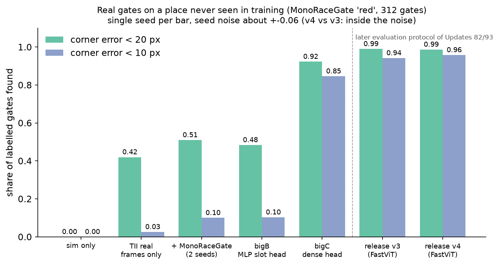
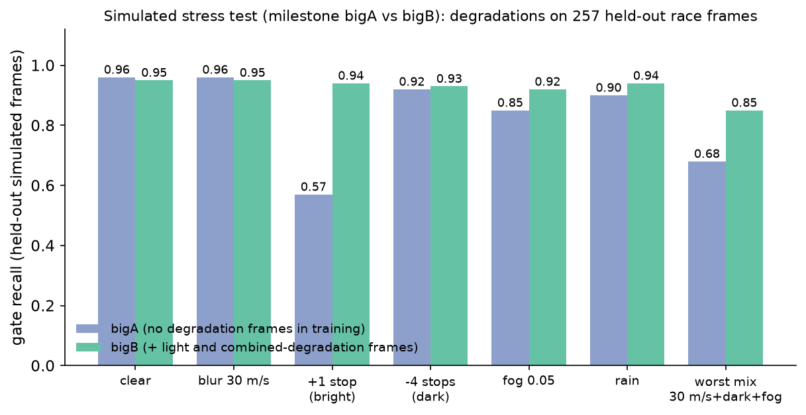
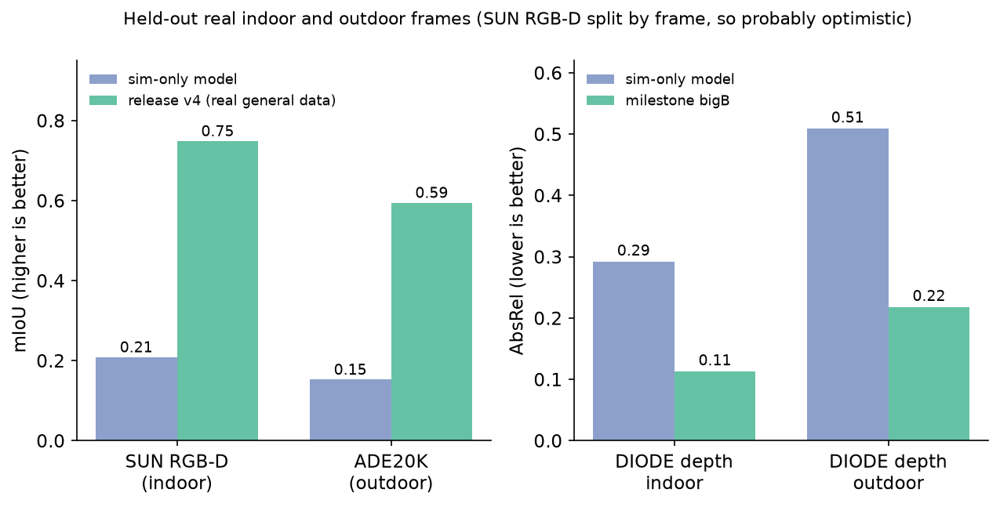
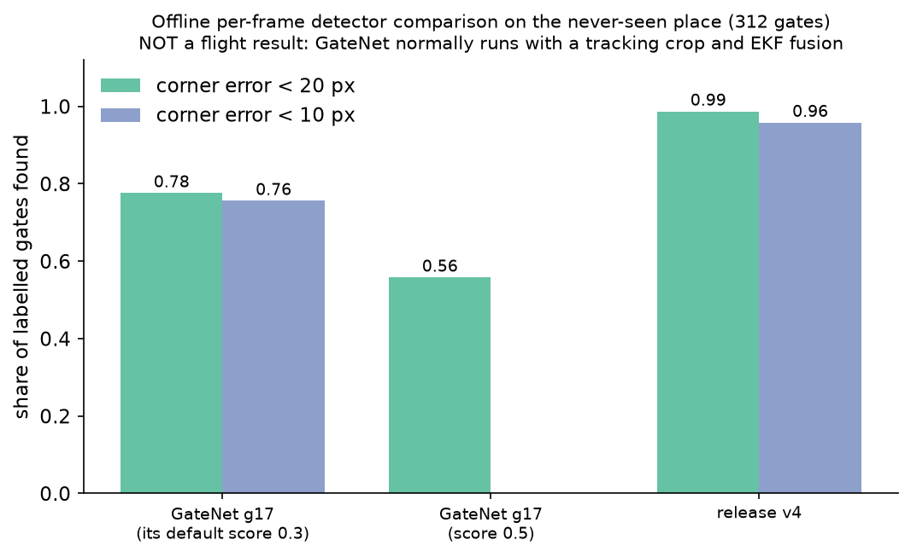

🇬🇧 [English](README.md) · 🇹🇷 Türkçe

# PerceptionModel

**Drone yarışı için küçük bir görüntü ağı: tek kamera görüntüsünden yarış kapısı köşeleri, derinlik ve sahne segmentasyonu; simülasyon ve gerçek veriyle eğitildi.**

ViT-B veya FastViT öğrencisi, DINOv2-S ve Depth Anything V2-S öğretmenlerinden (önbelleğe alınmış öğretmen özellikleri) damıtılıyor. Eğitimde Isaac Sim'in kesin etiketleri ile gerçek yarış, iç mekân ve dış mekân veri setleri birlikte kullanılıyor. Güncel sürüm (v4), FastViT-SA24 melez ağıdır (11,0 M parametre, RTX 5090'da TensorRT fp16 ile 0,89 ms, yalnızca GPU hesabı). Kare başına en çok 8 kapıyı [skor, 4 köşe] olarak verir. Hedef, kapı tabanlı bir yarış yazılımını besleyen Jetson Orin NX.



*Eğitimde hiç görülmemiş bir yerden (MonoRaceGate "red") gerçek kareler. Beyaz = etiket. Sol: bigB (global slot başlığı), kırmızı = tahmin. Sağ: bigC (yoğun kapı başlığı), yeşil = tahmin. Güncel sürüm bundan da iyi, bkz. Sonuç 1.*

## Özet

| Problem | Yöntem | Simülasyon / donanım | Makale |
|---|---|---|---|
| Kapı köşeleri (görüntüden kısmen taşanlar dahil), derinlik ve sahne segmentasyonunu; yüksek hızda, bulanıklık, sis, yağmur ve düşük ışıkta, tek küçük ağdan çıkarmak | Çok öğretmenli özellik damıtma + kesin simülasyon etiketleri + gerçek etiketli setler; yoğun kapı başlığı (merkez ısı haritası ve köşe ofsetleri); veri artırma; kapısız gerçek negatifler | Isaac Sim 6.0 veri fabrikası (LLM'in bildirimsel yerleşimleri, çözücüyle doğrulanır); eğitim için bir RTX 5090; hedef Jetson Orin NX 8 GB | TODO: henüz makale yok (`paper/` boş). Proje raporu (Türkçe, 4. baskı): [docs/report/PerceptionModel_rapor_v4.pdf](docs/report/PerceptionModel_rapor_v4.pdf) |

### Sistem mimarisi



İki öğrenci aynı başlıkları paylaşır: düz ViT-B/16 ve FastViT melez ağı (TensorRT dostu, sürüm modeli). Öğretmenler dondurulmuştur, özellikleri bir kez önbelleğe alınır. Kapı çıktısı bir yarış yazılımının girdisi düzenindedir: bir skor ve görüntü dışına taşabilen dört köşeden oluşan yuvalar.

### Akış şeması (nasıl çalışır)



## Seçilmiş sonuçlar

Aksi belirtilmedikçe tüm sayılar tek tohumludur. 312 kapılık gerçek testte tohum gürültüsü yaklaşık ±0,06'dır. Simülasyon sayıları başarı oranı değildir ve bu ağla gerçek bir uçuş yapılmadı.

### Sonuç 1: eğitimde hiç görülmemiş yerdeki gerçek kapılar



Yalnız simülasyonla eğitilen öğrenciler gerçek kapıyı neredeyse hiç bulamıyor. Gerçek kareler ve özellikle veri artırma ve kapısız negatiflerle yoğun kapı başlığı, MonoRaceGate "red" üzerinde (196 görüntü, 312 kapı, hiç eğitilmedi) 20 px içinde (256x192 ölçeği) bulunan kapı payını yaklaşık 0,5'ten 0,92'ye (bigC), sonraki tariflerle 0,99'a (v3) ve 0,99'a (v4) çıkarıyor. 10 px içinde 0,94 ve 0,96; iki sürüm tohum gürültüsünün içinde. Kesikli çizginin sağındaki çubuklar daha sonraki bir değerlendirme protokolünden geliyor ([Update 82 ve 93](docs/experiment-log.md)). Tek bir yer ve tek bir kamera türü.

### Sonuç 2: simülasyon stres testi



Işığı çeşitlendirilmiş ve birleşik bozulmalı eğitim kareleri, parlak ışıktaki çöküşü kapatıyor (+1 stop: 0,57'den 0,94'e) ve zor bir durumu (30 m/s bulanıklık + karanlık + sis) 0,68'den 0,85'e çıkarıyor (ara modeller bigA ve bigB, eski sıra tabanlı ölçüt). Güncel sürüm en zor karışımda hâlâ zayıf: simülasyonda yaklaşık 0,60 kapı bulma.

### Sonuç 3: gerçek iç ve dış mekân kareleri



Proje sınıflarına eşlenmiş herkese açık iç ve dış mekân setleri, görülmemiş gerçek karelerde segmentasyonu 0,21 / 0,15 mIoU'dan 0,75 / 0,60'a (SUN RGB-D / ADE20K) çıkarıyor ve derinlik hatasını yarıya indiriyor. SUN RGB-D ayrımı kare bazlı, büyük olasılıkla iyimser. Sürüm ayrıca şerit çizgisi IoU 0,80 ve yol, drone ve arazi setlerinde sıfır atış sonuçları veriyor, bkz. [Update 93](docs/experiment-log.md).

### Sonuç 4: yarış yazılımının kendi kapı bulucusuyla karşılaştırma (çevrimdışı)



Aynı görülmemiş yerde DroneRacing GateNet g17 (yalnız simülatör verisiyle eğitilmiş) varsayılan eşiğinde kapıların 20 px içinde 0,78'ini buluyor, bizimki 0,99'unu. Bu, kare kare bir dedektör karşılaştırmasıdır; GateNet normalde takip kırpması ve EKF birleştirmesiyle çalışır, test bunları içermez. Uçuş başarı oranı değildir. Simülasyonda kapalı döngü kapı geçişi (6 görülmemiş yerleşim, basit nokta kütle kontrolcüsü) son modellerin hepsinde doymuş durumda (175/176 kapı), modelleri ayırt etmiyor.

*Tüm şekiller `plots/` klasöründe. Açık işler: sürüm ağırlıklarının Orin doğruluğu ve hızı, hedef dronun gerçek kamerası (simülasyon 130 derecelik kamera kullanıyor), 8 pikselden küçük kapılar, uçuşlar. Her deney ve çekincesi: [docs/experiment-log.md](docs/experiment-log.md) (İngilizce).*

## Kurulum

Gereksinimler: Linux, Python 3.12, NVIDIA GPU (eğitim RTX 5090 üzerinde, PyTorch'un CUDA 12.8 sürümüyle yapıldı), `uv` veya `pip`.

```bash
git clone https://github.com/GulogluHaktan/PerceptionModel.git
cd PerceptionModel
uv venv --python 3.12 .venv
uv pip install -p .venv/bin/python -e . pytest
.venv/bin/python -m pytest tests -q          # beklenen: tüm testler geçer (yazıldığı anda 65)
```

`requirements.lock`, iş istasyonunda kullanılan sürümleri sabitler. Isaac Sim betikleri (`sim/`, `scripts/layout_to_job*.py`) Isaac Sim 6.0 ister ve isteğe bağlıdır.

## Kullanım

Bu repoda yayımlanmış eğitilmiş model yok. Sahte veriyle duman testi tüm hattı doğrular:

```bash
.venv/bin/python scripts/make_fake.py
.venv/bin/python scripts/cache_teachers.py configs/smoke.yaml
.venv/bin/python scripts/train.py configs/smoke.yaml
```

Beklenen çıktı: her epoch için bir JSON satırı, örneğin `{"epoch": 0, "loss": ..., "sec": ..., "peak_gb": ...}`, bir altın set ölçüm satırı (sahte veri, yani anlamsız sayılar), ardından yapılandırmadaki `out_dir` altında `final.pt`.

Gerçek veri setleri `scripts/*_prepare.py` betikleriyle indirilip dönüştürülür. Veri setleri bu repoda yeniden dağıtılmaz (Veri ve lisanslar bölümüne bak).

## Sonuçları yeniden üret

Deney zincirleri tek bir iş istasyonunda çalıştı ve önceki adımların oluşturduğu ara klasörleri (`data/mix/...`) bekler. Günlük her adımı ve tarifin tam anahtarlarını anlatır.

| Şekil | Komut |
|---|---|
| `plots/sonuc_1.png` | eğitim: `KIND=hybrid python scripts/bige_chain.py <etiket> '<anahtar: değer>' ...` (v3 ve v4 tarifleri günlüğün Update 79-93 bölümlerinde); değerlendirme: `PFM_GATE_HEAD=dense GOLDEN=data/real_mrg/golden FLIGHTS=red_s1_f1,red_s1_f2,red_s1_f3 CKPT=runs/<etiket> python scripts/eval_real_golden.py` |
| `plots/sonuc_2.png` | `KINDS=vit CKPT=runs/<etiket> python scripts/eval_robustness_sim.py 4` (eğitim: `scripts/bigb_chain.py`) |
| `plots/sonuc_3.png` | `scripts/diode_prepare.py`, `sun_prepare.py`, `ade_prepare.py`, ardından `python scripts/eval_depth_diode.py` ve `EVDIR=data/general/eval_ade python scripts/eval_seg_sun.py` |
| `plots/sonuc_4.png` | `python scripts/eval_dr_gatenet_real.py` (DroneRacing projesindeki GateNet ağırlıklarını ister) |
| kapalı döngü simülasyonu | `bash scripts/closed_loop_batch.sh` (Isaac Sim ve Isaac Lab ister) |
| ONNX / TensorRT | `python scripts/export_onnx.py ...`, `python scripts/trt_build.py ...` |
| `assets/architecture.png`, `plots/*.png` | `python scripts/make_readme_figures.py` (sayıları günlükten çizer) |
| `assets/real_gates_compare.jpg` | `python scripts/vis_real_gates.py` |

## Proje yapısı

```
PerceptionModel/
├── assets/        # README görselleri, 3B varlık üst verisi (ağ dosyaları git dışında)
├── configs/       # eğitim ve veri ayarları (yaml)
├── docs/          # deney günlüğü, rapor (Türkçe PDF), protokol, notlar
├── paper/         # makale (şimdilik boş)
├── plots/         # yukarıda kullanılan sonuç şekilleri
├── scripts/       # veri hazırlama, eğitim zincirleri, değerlendirmeler, dışa aktarım
├── sim/           # Isaac Sim sahne betikleri
├── src/pfm/       # model, kayıplar, eğitim, efektler, yerleşim çözücüleri, değerlendirme
├── tests/         # birim testleri
├── pyproject.toml
├── requirements.lock
└── README.md
```

## Veri ve lisanslar

Veri setleri hazırlama betikleriyle indirilir ve bu reponun parçası değildir. Yeniden kullanmadan önce her lisansı kontrol et. Eğitimde veya değerlendirmede kullanılanlar: TII Racing (CC BY 4.0, atıf gerekli, kareleri bazı şekillerde ve raporda görünür), MonoRaceGate (MIT), Hugging Face üzerinden ADE20K (BSD), Aeroscapes (CC BY-SA 4.0), SUN RGB-D ve DIODE (veri seti kartlarına bak). **Yalnızca araştırma veya ticari olmayan kullanım:** BDD100K, RUGD ve IDD-AW; UAVid ve KITTI CC BY-NC-SA. Bu kaynaklarla eğitilen ağırlıklar bu sınırı taşır; ticari kullanımda bu kaynaklar çıkarılıp model yeniden eğitilmelidir. 3B varlık kataloğunun ağ dosyaları (375 MB) git dışında tutulur, yalnızca küçük üst veri dosyaları sürümlenir.

## Atıf, lisans, iletişim

```bibtex
@misc{perceptionmodel2026,
  title  = {PerceptionModel: a small multi-task vision network for drone racing},
  author = {GulogluHaktan},
  year   = {2026},
  url    = {https://github.com/GulogluHaktan/PerceptionModel}
}
```

Lisans: TODO, henüz seçilmedi (bir lisans eklenene kadar kod tüm hakları saklıdır). İletişim: bu repoda bir issue aç.
